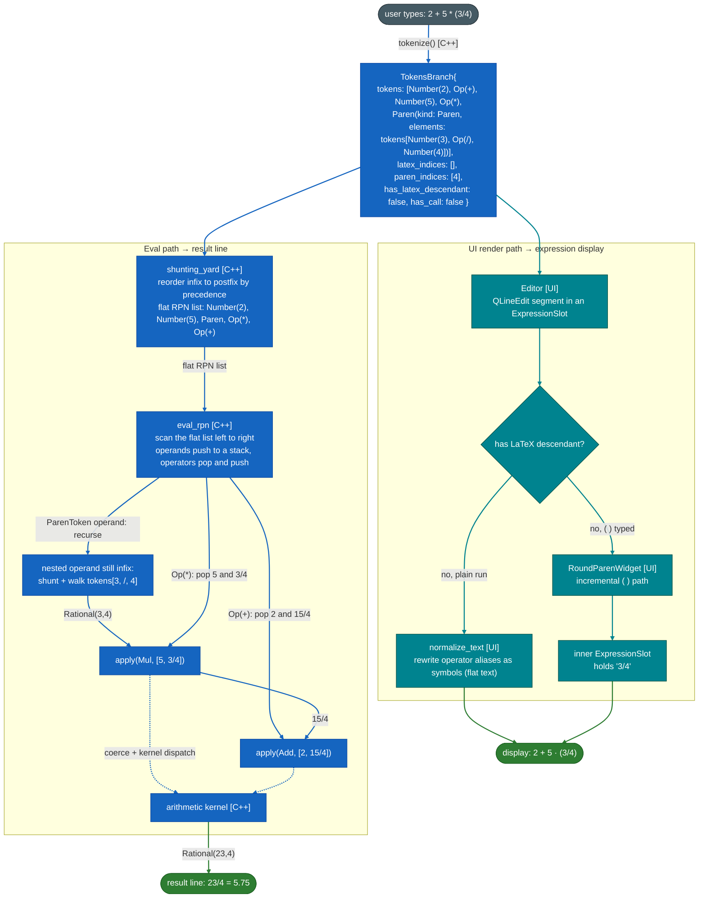
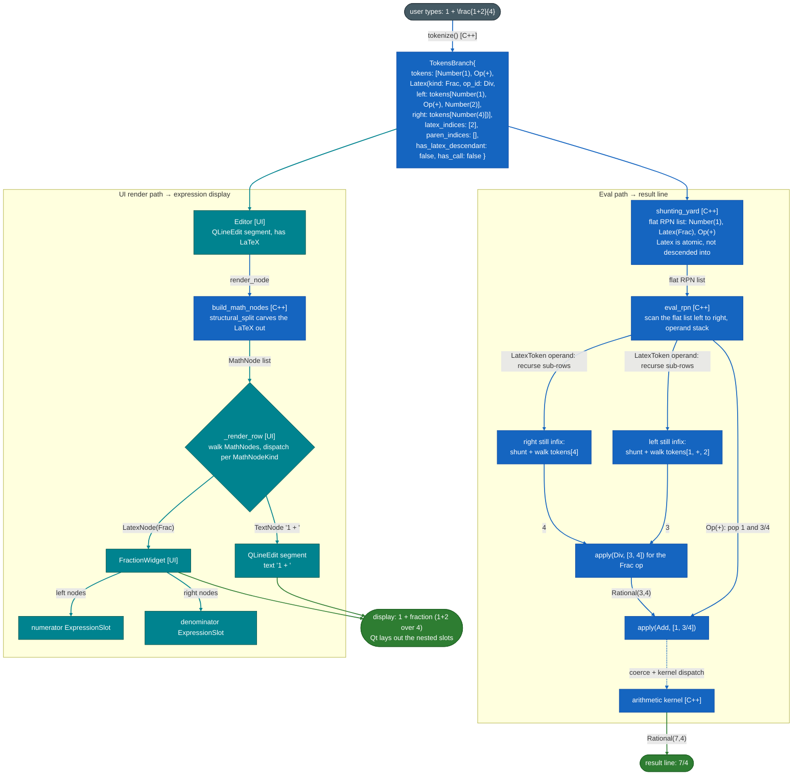
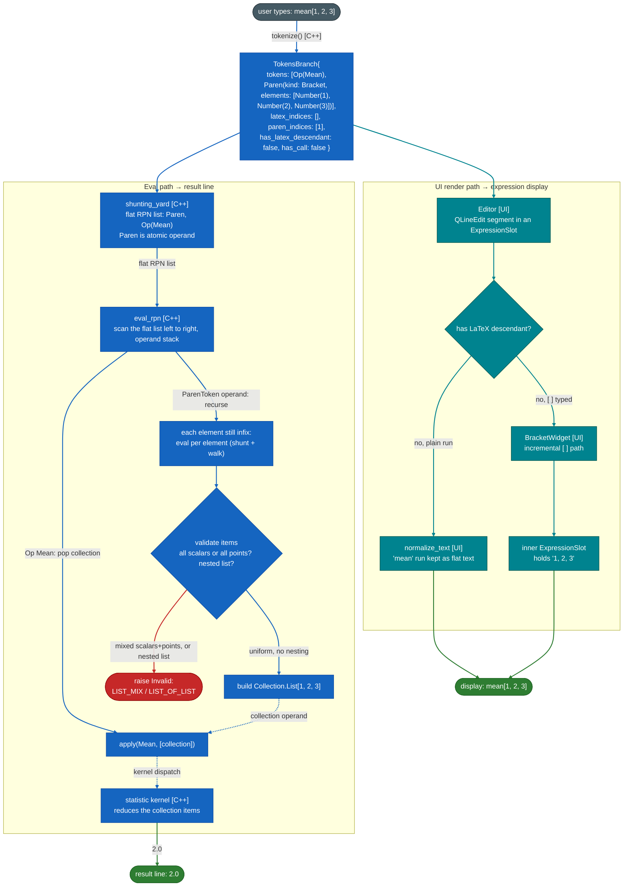

# Data flow examples

Three worked examples of the [data flow](./architecture.md#data-flow), one per shape an expression can take. Each diagram traces both paths. They share the same spine (tokenize once, fan out); the differences are where the interesting work happens. `tokenize` and `build_math_nodes` appear as single steps; their internals are in [parser.md](./parser.md).

## 1. Basic arithmetic: `2 + 5 * (3/4)`

A linear RPN walk, all in C++. A plain `( )` group holding a single element (arity-1: no
top-level comma) is just grouping: it evaluates recursively but returns a scalar, not
a collection.

## 2. LaTeX expression: `1 + \frac{1+2}{4}`

A LaTeX token is an atomic operand in the RPN stream. Its `left` and `right`
sub-rows are independently shunting-yard'd and evaluated, then the token's own op is
applied.

## 3. Collection: `mean[1, 2, 3]`

A `[ ]` (or `( )` point) is built into a native `Collection`, with validation, before any
op touches it. The same path serves the function-call form `mean(1, 2, 3)` (a `Call`
token) and reducers like `min` / `gcd`.

Collection building raises a few more validation errors that this example does not
hit, all from the collection arm of the evaluator: a point `( )` rejects a nested collection item
(`POINT_ITEM_COLLECTION`) and an empty `()` (`EMPTY_POINT`), and a `{ }` brace is not a
collection (`BRACE_UNSUPPORTED`). The call path adds arity checks: a fixed-arity call
with the wrong count (`takes_arguments`), a scalar function handed a collection
(`not_for_list_or_point`), and a call-only function typed bare without parentheses
(`needs_call_form`).
